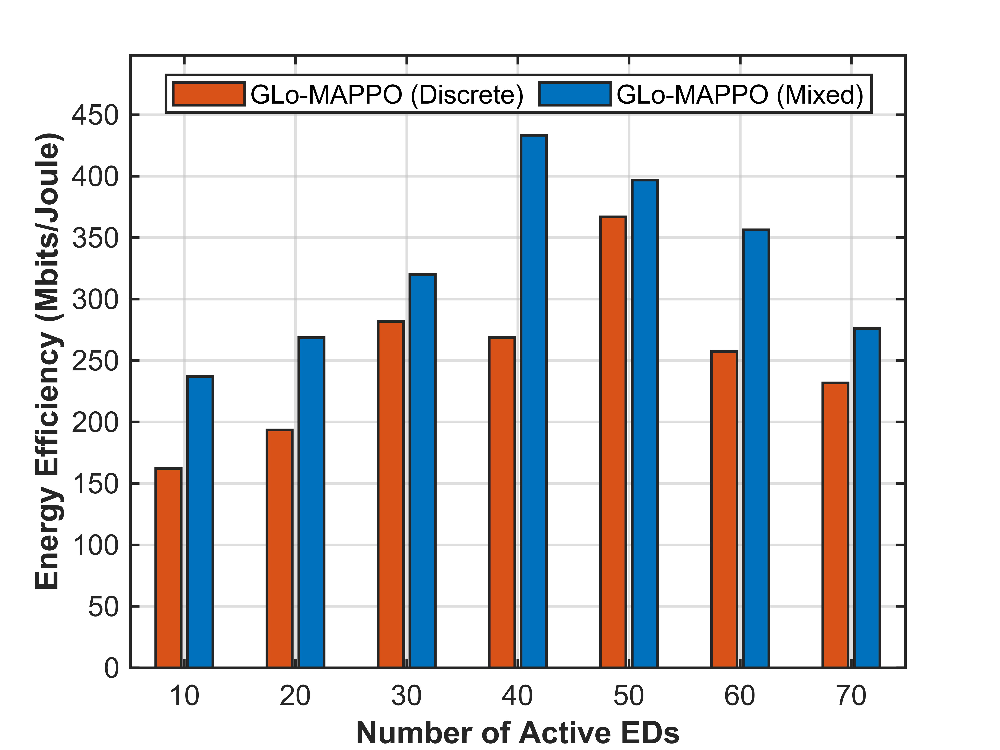

# GLo-MAPPO: Multi-Agent Deep Reinforcement Learning for Energy-Efficient UAV-Assisted LoRa Networks

This repository presents **GLo-MAPPO**, a framework based on Multi-Agent Proximal Policy Optimization (MAPPO) for joint UAV trajectory control, resource allocation and user association in UAV-assisted LoRa networks, with the objective of maximizing network energy efficiency.

Building on the initial implementation with a fully discrete action space, this version introduces a **hybrid action space** combining multiple discrete (SF and TP) and continuous (speed and direction) variables. The framework integrates policy-driven control with a channel-aware device association scheme.

**Code availability:** The hybrid-action implementation is being prepared for public release and will be made available in this repository soon.

We extended our proposed GLo-MAPPO approach to support mixed discrete and continuous actions (hybrid), and we also modified both the simulation environment and learning architecture accordingly. Specifically, the actor now contains separate continuous and discrete output heads. The continuous head parameterizes Gaussian distributions for the UAV movement direction and speed, while the discrete head produces categorical distributions for the SF and TP selections. Their log-probabilities and entropies are combined when evaluating the PPO clipped objective, enabling all four decisions to be learned jointly within a unified policy.
